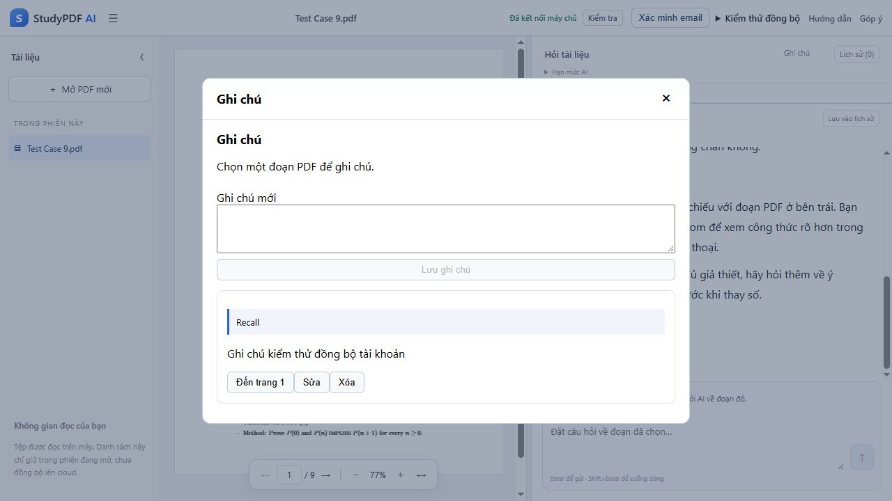

# Đồng bộ tài khoản và email — 20/11/2026

## Cấu hình người dùng tự điền

Giữ nguyên MongoDB/Gemini đang có. Thêm vào `.env` thật:

```dotenv
RESEND_API_KEY=
MAIL_FROM=
APP_PUBLIC_URL=http://127.0.0.1:5173
```

RESEND_API_KEY là khóa backend của Resend; MAIL_FROM là địa chỉ gửi hợp lệ của dịch vụ, ví dụ tên và địa chỉ thuộc domain đã xác minh. Không cần thêm dependency mail: backend gọi HTTP API Resend, timeout 10 giây. Tài liệu nhà cung cấp: https://resend.com/docs/api-reference/emails/send-email . Không đưa khóa vào frontend, Git hoặc env.example. APP_PUBLIC_URL phải nằm trong ALLOWED_ORIGINS; online dùng HTTPS. Restart `npm run dev` sau thay đổi .env. Mã không sửa .env hoặc đăng ký dịch vụ thay người dùng.

Nếu thiếu cấu hình mail, API gửi liên kết trả 503, các chức năng khác tiếp tục hoạt động. Nếu nhà cung cấp từ chối gửi, trả thông báo chung để không tiết lộ email tồn tại; backend log lỗi chung không chứa email/token/key. Kiểm tra cấu hình/domain và yêu cầu lại sau thời gian giới hạn. Không tuyên bố email đã được nhận vào hộp thư chỉ dựa trên HTTP 200.

## Lưu dữ liệu

`study_records`: userId lấy từ session, kind documents/entries/chat, key, revision, value. Unique index userId+kind+key; entries có index theo documentHash. Không lưu bytes PDF. ID từ frontend không dùng để xác định chủ sở hữu. Mọi đọc/ghi yêu cầu session còn hiệu lực và owner query khớp session (chặn request cũ sau đổi tài khoản). POST yêu cầu Origin allowlist, JSON, giới hạn 4MiB và 180 lần ghi/user/phút. GET entries giới hạn 1.000 ghi chú/PDF. Chat tối đa 500 lượt nháp, 200 archive, mỗi archive tối đa 500 lượt; giới hạn body thường đạt trước giới hạn số lượt. Khi vượt, cần giảm/chia dữ liệu; chưa có export UI.

GET `/api/study/{documents|entries|chat}/{key}?owner=user:ID` trả record, revision. GET entries với key=hash và list=1 trả ghi chú. POST cùng đường dẫn nhận `{revision,value}`, tạo revision=1 khi expected=0; cập nhật CAS. 409 không tự retry/overwrite. Xóa ghi chú lưu tombstone để client cũ không hồi sinh bản xóa. Chưa có cơ chế dọn tombstone hoặc tổng quota dung lượng từng tài khoản.

Frontend tuần tự hóa ghi theo record. Chat snapshot gửi theo nhịp tối thiểu 500ms; giữ stream trong RAM khi API lỗi, hiện cảnh báo và nút thử lưu. Chưa có hàng đợi offline hoặc local backup tự động cho dữ liệu tài khoản mới: không đóng/tải lại khi chưa xác nhận lưu, hãy sao chép dự phòng. Dữ liệu được đọc lại khi mở tài liệu/dialog; chưa realtime push. Có chống ghi đè giữa tab/thiết bị nhưng chưa UI merge conflict. HTTP timeout có thể đã ghi thành công phía server; cần tải lại sau khi sao chép nội dung để kiểm tra revision thực tế.

Guest tiếp tục IndexedDB. Dữ liệu tài khoản cũ không bị xóa/di chuyển tự động. Nút nhập trong Dữ liệu tài khoản chỉ nhập PDF đang mở và scope hiện tại, bỏ qua ghi chú ID đã có (kể cả tombstone), gộp archive theo ID, nháp cũ thành archive `local-HASH`. Có thể chạy lại sau lỗi; giữ nguồn local. Không chuyển dữ liệu guest vào tài khoản. Muốn truy cập trên máy khác, đăng nhập rồi mở cùng bytes PDF.

## Email và bảo mật

- POST `/api/auth/forgot-password` {email}: phản hồi chung cho địa chỉ tồn tại/không tồn tại.
- POST `/api/auth/resend-verification` {}: cần session; gửi tới email trong user, không nhận email đích từ client.
- POST `/api/auth/reset-password` {token,password}; POST `/api/auth/verify-email` {token}: cần Origin allowlist và JSON, không cần phiên (dùng link email).
- 32 byte ngẫu nhiên, token 64 hex, DB chỉ giữ hash + expiresAt + passwordHash tại lúc issue trong user. Reset 30 phút, verify 24 giờ. Không dùng TTL trên users để tránh xóa tài khoản. Kiểm tra hết hạn trong truy vấn và CAS tại lúc tiêu thụ.
- Link dùng fragment, frontend giữ token trong RAM và bỏ fragment khỏi URL, người dùng bấm form để tiêu thụ. Không GET mutation, không auto-consume do email scanner. Gửi lại thay token cũ. Đổi mật khẩu làm link cũ vô hiệu. Reset atomic: kiểm tra token/hash/hạn/passwordHash, cập nhật password, xóa token và tăng sessionVersion. Không tự đăng nhập sau reset.
- Giới hạn 15 yêu cầu email/IP/15 phút, 200 toàn hệ thống/15 phút, 3 lần phát hành/email/mục đích/15 phút, reset còn dùng giới hạn và concurrency hash hiện tại. Phản hồi không cam kết thời gian hằng định; chưa có hàng đợi email bền vững.
- Email verification là trạng thái, chưa gate AI/login hay thay đổi email. Đăng ký xong người dùng chủ động bấm Xác minh email. Tài khoản cũ chưa có emailVerifiedAt được xem là chưa xác minh.

## Kiểm thử

- Bộ test cloud-email: session isolation/guest/revocation, expected owner mismatch, CAS hai writer, Origin/body validation, notes/tombstone; email token hash, one-use, expiry, resend, stale password, phiên bị thu hồi, login mật khẩu mới và thiếu mail config.
- Test client: API adapter, note CRUD, draft/archive/rename, conflict, import idempotent và nguồn IndexedDB giữ nguyên.
- Test Mongo thật: `tests/integration/cloud-email-mongo.test.mjs`, chỉ chạy khi có MONGODB_TEST_URI riêng và MONGODB_TEST_ALLOW_WRITE=isolated-tests. DB test tên ngẫu nhiên, không dùng database ứng dụng. Chưa có bằng chứng chạy Mongo thật trong lượt này.
- UI fixture loopback, fake repo/mail/AI, không đọc .env: đăng ký, yêu cầu email xác minh, tạo chat/ghi chú, reload và mở lại PDF thật Test Case 9, xác nhận chat và ghi chú được tải qua API. Không gửi email thật hoặc gọi Gemini/MongoDB thật. Server fixture đã dừng.



Kết quả cuối: **111/111 test local qua**, lint, typecheck frontend/backend, build và kiểm tra secret đều đạt. Ba bộ Mongo integration được bỏ qua do chưa có URI kiểm thử riêng; không coi skip là đã xác minh Mongo thật.

## Cập nhật AI theo trang cùng ngày

Xem PAGE_BASED_AI_2026_11_20.md. Metadata có lastReadPage; chat thêm scope {kind,pages}. Dữ liệu cũ thiếu scope vẫn dùng pageNumber. GET chat hỗ trợ view=draft/summaries/archive; archive hỗ trợ id, offset, limit<=50, page. POST chat có operation save-draft/archive/rename; merge trên server rồi CAS, không đưa snapshot archive rút gọn từ client đè bản đầy đủ. Bản GET/POST đầy đủ cũ giữ cho import dữ liệu và tương thích; không đổi collection. Nội dung lưu tổng kiểm tra <=12MiB. Không tuyên bố đã tách collection chat_messages hay đã thực hiện migration production.
