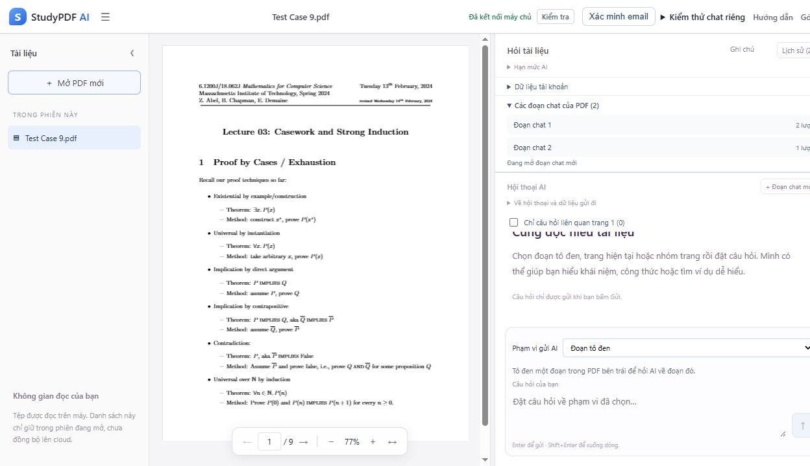

# Các đoạn chat riêng theo PDF — 23/11/2026

## Trải nghiệm

Mở một PDF tạo chat trống mới. Các chat đã có hiện trong danh sách Các đoạn chat của PDF, độc lập theo tài khoản và SHA-256. Không phải bấm Lưu vào lịch sử nữa: mỗi snapshot lưu cũng tạo/cập nhật mục tương ứng trong danh sách, từ câu hỏi đầu tiên. Chat trống không tạo mục rỗng. Tên mặc định tăng theo các chat thực sự có tin nhắn; giữ đổi tên thủ công.

Bấm Đoạn chat mới để bắt đầu lại bất cứ lúc nào. Bấm tên chat cũ để mở đúng tin nhắn và hỏi tiếp trong cùng ID; không tạo bản sao của chat đó. Có thể dùng lại đoạn nguồn cuối của chat cũ, có thông báo rõ, hoặc chọn đoạn/trang khác. Việc đổi/mở chat không gọi AI. Chỉ Gửi/Dịch/Giải thích gọi provider. Khi đang stream, cần dừng hoặc chờ trước khi chuyển. Câu hỏi đang gõ chưa gửi không được lưu theo chat.

## Lưu trữ, tương thích và chống đua

Giữ collection study_records và dữ liệu cũ. Chat record thêm activeId, activeTitle, openingId, nextConversationNumber. Chat có tin nhắn nằm trong archives và vẫn ở đó khi đang được mở; autosave cập nhật đúng ID (có bản snapshot active riêng để tiếp tục luồng cũ). Hiện vẫn là mô hình snapshot bounded, chưa collection tin nhắn độc lập. Giới hạn 200 chat, 500 lượt/chat và tổng record 12MiB vẫn áp dụng; snapshot active bị tính trong tổng dung lượng. Không hứa lịch sử vô hạn.

Shared transitions ở shared/ai/conversations.ts:

- open-new: nonce mỗi lần user mở PDF, tạo activeId mới và cất chat trước nếu có; lặp lại cùng nonce giữ nguyên chat, phục hồi stream dở thành stopped. Nonce nằm ở PdfViewer nên refresh auth/focus không tạo đoạn chat mới ngoài ý muốn.
- new-chat: cất snapshot hiện tại và đổi activeId, giữ nonce lần mở PDF để auth remount không mở thêm chat.
- resume: lưu snapshot hiện tại rồi chọn đúng ID có sẵn, giữ title và mọi chat khác.
- save-draft: đồng thời cập nhật snapshot active và mục cùng ID trong danh sách. rename cập nhật cả activeTitle nếu đổi tên chat đang mở.

Client gọi beginConversation/switchConversation/persistConversation; backend merge trong một record update có CAS. expectedActiveId chặn request cũ ghi nhầm chat sau khi tab khác đổi activeId, kể cả cache revision đã được tải mới. UI không tự overwrite/resolve conflict; sao chép phần chưa lưu rồi tải lại khi có 409.

Nháp đơn từ bản cũ được giữ thành một chat (stream dở đổi stopped), archive cũ không bị xóa, nguồn IndexedDB cũ vẫn giữ. Không chạy migration database thật trong lượt này. Các thao tác backend cũ giữ tương thích cho import; cần restart backend và reload frontend sau cập nhật.

## Kiểm thử

Bổ sung kiểm thử nonce/idempotency, chat trống, tự lưu từ câu hỏi đầu, mở chat mới, resume cùng ID, giữ tên tùy chỉnh, tách ngữ cảnh, nháp cũ/stream dở, adapter IndexedDB và API CAS/expectedActiveId. Tổng 122 test local đã qua trước QA.

UI fixture riêng loopback (không .env, MongoDB/Gemini/mail thật): mở Test Case 9.pdf, hỏi trong chat 1; Chat mới tạo khung trống và giữ chat 1; hỏi trong chat 2; mở chat 1, hỏi tiếp thấy 2 lượt, chat 2 vẫn 1 lượt; mở lại PDF và reload/chọn lại PDF đều có khung trống cùng danh sách chat 1/2. Không có thao tác Lưu thủ công. Server fixture đã được dừng.

