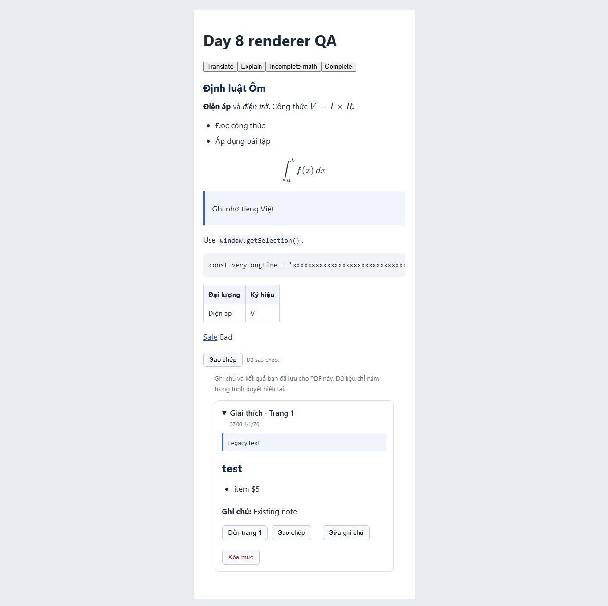

# DAY 8 STATUS — 03/11/2026

## RENDERING

- Translate: plain text, `white-space: pre-wrap`, không parse Markdown.
- Explain/Ask: Markdown, GFM table, inline/block math, headings, list, quote, code.
- `AiResponse` được memo theo action/source để tránh parse khi parent đổi state không liên quan.
- Streaming: test source chưa hoàn chỉnh/malformed không throw; renderer cập nhật khi source đổi.
- Không đổi viewport PDF, selection, streaming transport, Save/Copy hoặc backend prompt.

## SECURITY

- `skipHtml:true`, không rehype-raw, không dangerouslySetInnerHTML.
- Markdown images bị loại bằng `disallowedElements:['img']`; test HTML output không có img/script.
- Chỉ URL explicit http/https/mailto; relative/protocol-relative và protocol khác bị vô hiệu hóa.
- Link mở tab mới có `noopener noreferrer`.
- KaTeX `trust:false`, `maxExpand:1000`, `maxSize:20`; lỗi có màu trung tính.
- Cấu hình truyền `throwOnError:false`. Lưu ý rehype-katex 7.0.1 tự quản lý cờ này:
  nội bộ thử true rồi catch và render lại false. Malformed source không thoát exception ra UI.
- KaTeX trực tiếp 0.19.1; override `$katex` đồng nhất cả rehype-katex/micromark-extension-math
  vốn kéo 0.16.47 có GHSA-238p-pmpm-9mq7. Đây là override ngoài range upstream;
  đã kiểm tra math/security hiện có, cần giữ kiểm thử khi cập nhật dependency.

## COMPATIBILITY

- Live/history dùng chung component; DB giữ nguyên source, không generated HTML, không migration.
- Bản lưu cũ Explain/Ask cũng parse Markdown; `# test` và `- item` đổi hình thức hiển thị.
- Đã browser-test legacy fixture riêng, không sửa/xóa dữ liệu lịch sử thật.
- Copy source đã xác nhận bằng click Copy rồi Ctrl+V vào textarea: Markdown và một backslash LaTeX còn nguyên.
- Dev font hiển thị đúng trong browser. Static relative build có 59 tham chiếu font KaTeX,
  tất cả đường dẫn tương đối và file tồn tại; tổng font 1,072,948 bytes. Chưa deploy lên hosting thật.

## TESTS

- `npm test`: 64/64 PASS (9 test renderer mới, không framework mới, renderToStaticMarkup).
- `npm run lint`: PASS.
- `npm run build`: PASS (cảnh báo chunk >500 KB).
- `npm run build:static`: cấu hình thực hiện tại FAIL vì thiếu VITE_AI_API_URL.
  Build kiểm chứng riêng PASS với biến tiến trình `https://api.example.invalid`, không sửa .env;
  URL giả chỉ kiểm tra đóng gói/relative-base, không chứng minh API online hoạt động.
- `npm audit`: exit 1, critical 0 / high 0 / moderate 12 / low 0.
  Các cảnh báo còn lại thuộc toolchain ESLint/minimatch đã có; không nâng dependency ngoài phạm vi.
- `npm audit --omit=dev`: 0 vulnerabilities. Không audit fix --force.

## PACKAGES ADDED

- react-markdown 10.1.0
- remark-gfm 4.0.1
- remark-math 6.0.0
- rehype-katex 7.0.1
- katex 0.19.1 (cả dependency gián tiếp qua override)

## BUNDLE IMPACT

Số production build, KB thập phân; worker PDF không đổi, font tách riêng:

| Asset | Before | After | Difference |
| --- | ---: | ---: | ---: |
| JS | 850.70 KB | 1,288.98 KB | +438.28 KB |
| JS gzip | 258.35 KB | 390.79 KB | +132.44 KB |
| CSS | 238.90 KB | 270.01 KB | +31.11 KB |
| CSS gzip | 43.93 KB | 52.33 KB | +8.40 KB |

Lazy-load renderer có thể giảm tải ban đầu trước khi dùng AI; đề xuất đo trên thiết bị/mạng mục tiêu
trước khi thêm vì lần mở kết quả đầu tiên có thêm độ trễ. Chưa tự lazy-load.

## FILES CHANGED

- src/components/AiPanel/AiResponse.ts (mới)
- src/components/AiPanel/AiPanel.tsx
- src/components/Study/HistoryPanel.tsx
- src/index.css
- tests/ai-response.test.mjs (mới)
- package.json, package-lock.json
- README.md, docs/DAY_08_STATUS.md, docs/DAY_08_RENDERER_PREVIEW.png
- Fixture QA nằm trong tmp/ bị ignore, không thuộc mã ứng dụng.

## KNOWN LIMITATIONS

- `Giá từ $5 đến $10.` bị parse đoạn giữa hai dấu $ thành math trong Explain/Ask.
  Không thêm heuristic tiền tệ; Translate không bị ảnh hưởng. Source cần escape dollar khi là tiền tệ.
- `\[...\]` và `\(...\)` chưa render math; test đã xác nhận.
- Legacy Explain/Ask có Markdown ngẫu nhiên sẽ đổi hiển thị; chưa thêm metadata định dạng.
- Chưa browser-test dữ liệu IndexedDB cũ thật hoặc toàn bộ regression PDF/AI live trong Day 8.
- Font static xác minh đường dẫn/file; chưa xác nhận HTTP trên hosting thật.

## MANUAL TESTS REQUIRED

Đã kiểm tra browser fixture: heading/list/bold/italic, tiếng Việt, inline/block math, code dài cuộn,
table, safe/unsafe links, raw HTML/image bị bỏ, Translate literal, incomplete math màu trung tính,
legacy fixture và copy/dán source. Panel fixture 460px không tràn ngang trang.

Cần chạy app với PDF thật để kiểm tra thêm: cả ba tác vụ với Gemini live; Stop/Retry; page/zoom/FitWidth
trong stream; lưu mới/mở lại từ IndexedDB; ghi chú/sửa/xóa/jump source; lịch sử cũ thật;
công thức/bảng rất dài, mobile; static hosting HTTP/font. Không đánh dấu các bước này PASS từ unit test.

## LATEX DELIMITER DECISION

- Current behavior `\[...\]`: ordinary text, không math.
- Current behavior `\(...\)`: ordinary text, không math.
- A: preprocess code-aware giúp cả legacy và output tương lai nhưng thêm logic delimiter/escaping,
  phải kiểm thử code fences/inline code; chưa triển khai theo yêu cầu chỉ đề xuất.
- B: thêm câu system prompt yêu cầu `$...$`/`$$...$$` đơn giản hơn, không thêm parser;
  không chữa legacy và model vẫn có thể không tuân thủ.
- Recommended: B cho output mới, chờ người dùng duyệt; nếu cần tương thích legacy, cân nhắc A sau.
- Backend change required: YES cho B; chưa thay đổi backend.

## FINAL VERDICT

COMPLETE WITH LIMITATIONS. Chưa commit/push/tạo branch/deploy. Không sửa .env.
