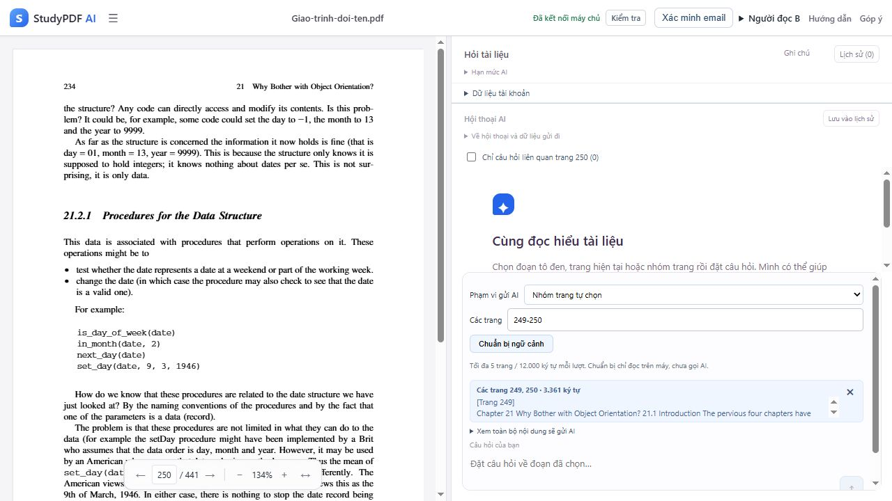
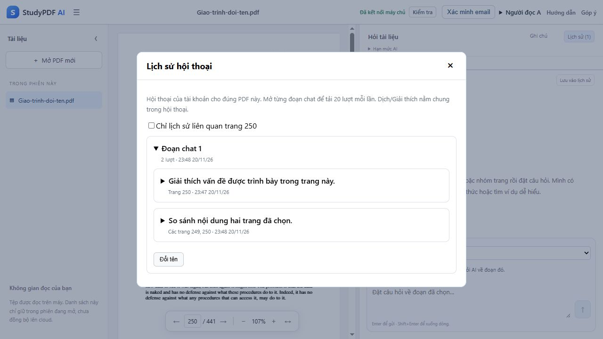

# PDF Viewer + Page-based AI + Persistent Document History

## Quy tắc sản phẩm

Mở PDF chỉ đọc/render trên máy, không gửi PDF lên backend và không gọi AI. SHA-256 chạy trên toàn bộ bytes để nhận diện file, khác với quét văn bản/gửi cho AI. User+hash là ranh giới dữ liệu; đổi tên cùng bytes khôi phục lịch sử, thay bytes/metadata PDF tạo hash mới. Không liên kết phiên bản tự động.

Ba phạm vi do người dùng chọn: đoạn tô đen, trang hiện tại, nhóm trang. Dịch/Giải thích trên đoạn chọn vẫn gửi vào chat. Không có tự tóm tắt toàn PDF, RAG/vector DB hay embedding. Tóm tắt một trang/nhóm trang có thể yêu cầu bằng câu hỏi tự nhập. OCR, tìm kiếm PDF, Admin Dashboard và thư viện object storage chưa triển khai, theo phần nhận xét đã chốt.

## Cách dùng

1. Chạy npm run dev ở gốc, đăng nhập, mở PDF.
2. Giữ Đoạn tô đen để hỏi đoạn cụ thể. Hoặc chọn Trang hiện tại / Nhóm trang tự chọn, nhập dạng 249-250, 252.
3. Bấm Chuẩn bị ngữ cảnh: chỉ gọi PDF.js getTextContent cho các trang yêu cầu, chưa gọi Gemini. Xem số trang, số ký tự và mở Xem toàn bộ nội dung sẽ gửi AI.
4. Nhập câu hỏi rồi Gửi. Tối đa 5 trang và 12.000 ký tự mỗi lượt. Nếu quá dài, chọn ít trang hoặc tô đen; không cắt âm thầm. Không có lớp chữ báo cần OCR. Đổi trang ở chế độ Trang hiện tại làm bản chuẩn bị cũ mất hiệu lực, phải chuẩn bị lại.
5. Checkbox phía trên chat lọc những lượt có phạm vi bao gồm trang đang đọc. Nháp hiển thị 20 lượt cuối và cho xem thêm, dữ liệu không bị xóa khi lọc.
6. Lưu đoạn chat vào lịch sử để bắt đầu đoạn chat mới. Lịch sử có lọc theo trang, tải từng đoạn chat 20 lượt/lần, có xem thêm và đổi tên.
7. Đóng/mở lại, chọn đúng PDF; trang đọc và dữ liệu được khôi phục theo tài khoản. Tài khoản khác có vị trí đọc/lịch sử riêng.

## Ranh giới AI

Shared ContextScope gồm kind selection/page/pages và mảng trang. Chỉ một trang cho selection/page, tối đa 5 trang cho pages. Server validate trước khi trừ quota/gọi provider. Text trên các trang được đánh dấu [Trang N]. Phạm vi được gửi cùng excerpt và lưu ChatExcerpt. Prompt nói rõ chỉ biết phần gửi, phải báo thiếu ngữ cảnh thay vì đoán nội dung trang khác. Lịch sử cho model tối đa 6 lượt gần nhất, tổng 6.000 ký tự; độc lập lịch sử hiển thị.

Backend không có toàn bộ PDF nên không thể xác thực rằng nhãn trang client gửi là nội dung thật của trang đó; đây là mô tả phạm vi user cung cấp, không phải cơ chế phân quyền hay trích dẫn được backend chứng thực. Các thao tác/tài liệu chỉ là dữ liệu, không phải system instruction.

## Vị trí đọc và tài nguyên

lastReadPage nằm trong DocumentRecord; đọc metadata trước, kiểm tra 1..numPages, không ghi đè nếu đọc lỗi. Không ép quay về trang cũ nếu người dùng đã tự chuyển trang trong lúc chờ. Lưu có debounce 800ms, cố gắng flush khi pagehide/ẩn tab bằng request metadata keepalive. Đây không phải bảo đảm lưu được khi thiết bị mất mạng/tắt đột ngột; cảnh báo chưa lưu phải được xử lý trước khi đóng.

Không có trần số trang. Guard tài nguyên: 150MiB/file, danh sách phiên tối đa 24 file/300MiB, vẽ một trang, giới hạn canvas 16 triệu pixel và mỗi chiều 8192, hủy render và xóa bộ đệm khi thay trang. Hash hiện vẫn đọc toàn bộ ArrayBuffer, không phải streaming hash. Chưa có OCR, password PDF dialog hoặc phiên bản tài liệu liên kết.

## Lưu trữ và tương thích

Không đổi collection chỉ để khớp tên trong đề xuất: giữ users/sessions và study_records đã có, ranh giới unique userId+kind+key. Documents tương đương user_documents logic; chat snapshot chứa các cuộc hội thoại có id/title và các lượt question/answer/context. Chưa tách collection conversations/chat_messages/notes vật lý. Giới hạn snapshot 12MiB, nháp 500 lượt, archive 200 và 500 lượt/archive vẫn áp dụng; không phải lịch sử vô hạn.

GET chat view=draft trả nháp + archive summaries (turnCount, pages, turns rỗng). view=summaries không trả bodies. view=archive&id=...&offset=...&limit=20&page=... trả tin nhắn theo từng đợt; limit tối đa 50. Danh sách summary được tải một lần (tối đa 200) và UI hiển thị 20 đoạn chat mỗi đợt. Nháp hiện tại vẫn tải đủ tối đa 500 lượt để tiếp tục hội thoại/autosave an toàn; chỉ DOM được chia 20 lượt. Backend hiện đọc record rồi cắt view, chưa tối ưu projection hoặc message-per-record ở MongoDB. Không gọi phân trang UI này là một kiến trúc lưu trữ tin nhắn không giới hạn.

POST operation=save-draft/archive/rename lấy bản server, hợp nhất tác vụ, validate và compare-and-swap revision. Client ghi nháp chỉ gửi nháp, không gửi lại toàn bộ lịch sử; server giữ archives đầy đủ. Archive và clear nháp vẫn trong một Mongo document update. Xung đột trả 409, không tự ghi đè. GET/POST đầy đủ cũ còn phục vụ import local. Dữ liệu cũ thiếu scope suy ra từ pageNumber, không tự xóa/migrate. Guest vẫn IndexedDB; user dùng MongoDB qua API. PDF bytes chưa lên cloud.

## Kiểm thử và giới hạn bằng chứng

- 117 test local qua ở lần kiểm tra trước QA: phạm vi/trang hợp lệ, 1.250 trang giả lập qua interface, chỉ trích trang yêu cầu, scan/quá dài/abort, không gọi mạng khi chuẩn bị; prompt thiếu ngữ cảnh; 65 lượt tải đủ theo đợt và lọc trang; draft/archive/rename giữ nguyên nguồn; kiểm tra page bounds, CAS, principal isolation và client adapter.
- UI fixture riêng 5181/3019, repo/AI/mail giả, không đọc .env hoặc gọi dịch vụ thật. PDF thật Test Case 8 có 441 trang: hỏi trang 250, nhóm 249-250 (2.006/3.361 ký tự), lúc chỉ chuẩn bị chưa có chat-turn; gửi hai lượt rồi archive; mở/lọc lịch sử thấy hai lượt. Reload và mở bản sao đổi tên giữ nguyên bytes: khôi phục trang 250 và Đoạn chat 1. Logout A, đăng ký B: trang 1, lịch sử trống trên cùng PDF. Màn hình 390x844 body rộng đúng 390, đã reset viewport.
- Chưa có PDF thật 1.000 trang để tuyên bố đã kiểm thử đầy đủ tiêu chí 1.000 trang. Không tạo PDF giả thay bằng chứng tài liệu thật.
- Chưa xác minh MongoDB thật, Gemini live hoặc HTTPS staging trong lượt này; integration cần DB test riêng. Kiểm thử fake không là bằng chứng triển khai production.

