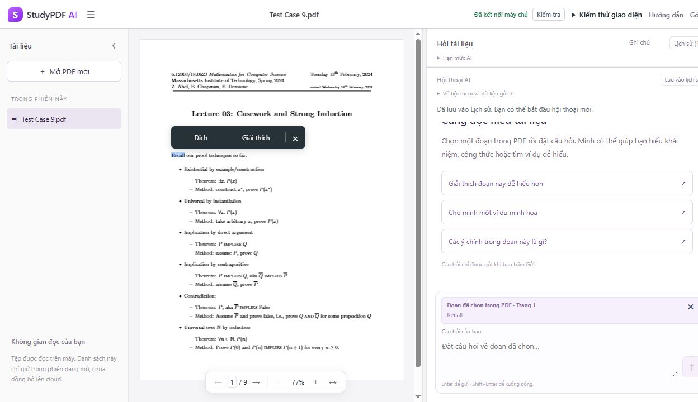
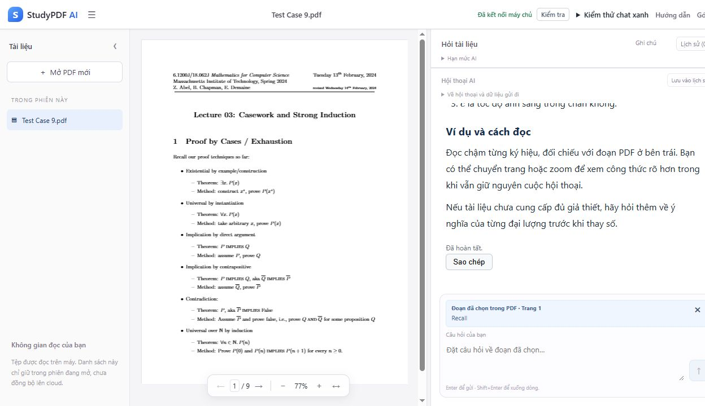

# Giao diện theo ảnh tham chiếu — 18/11/2026

## Thay đổi

- Danh sách PDF trong phiên bên trái, có nút mở PDF và đóng/mở danh sách; File giữ trong RAM và lọc theo ownerScope, tối đa 24 mục. Chưa đồng bộ tệp lên cloud.
- PDF ở giữa, chat bên phải, thanh chia 8px kéo được. Kéo sang phải tăng chiều rộng PDF; mặc định 50%, double-click đặt lại. Hỗ trợ bàn phím và nút thu gọn.
- ResizeObserver tính lại zoom ở chế độ vừa chiều rộng; zoom thủ công được giữ tới khi bấm Vừa chiều rộng.
- Điều khiển trang/zoom nổi dưới PDF. Thanh Dịch/Giải thích màu tối cạnh vùng tô đen; kết quả nằm trong PDF. Không tự gọi AI khi chọn chữ.
- Header gọn, câu hỏi gợi ý chỉ điền nội dung, chat và lịch sử giữ hành vi hiện tại.

## Kiểm tra trình duyệt

Chạy fixture riêng trên loopback 5181/3019 với repository và AI provider giả, không đọc .env, không gọi Gemini hoặc MongoDB thật. Dùng tài khoản thử trong RAM và PDF `Kiểm thử/Test Case 9.pdf` (9 trang).

- Kéo thanh chia: chiều rộng PDF từ 525px lên 669px, zoom vừa chiều rộng từ 77% lên 100%.
- Tô đen Recall hiện công cụ ngay cạnh vùng chọn.
- Gửi câu hỏi nhận phản hồi giả; đóng/mở danh sách tài liệu giữ phản hồi.
- Lưu đoạn chat vào lịch sử tạo mục lịch sử và trở về màn hình bắt đầu.
- Viewport 390×844: body rộng đúng 390px, danh sách tài liệu mở/đóng được; trở về viewport mặc định sau kiểm tra.
- Đã dừng server fixture sau QA. Không khẳng định đã kiểm thử dịch vụ AI hoặc database thật trong lượt này.

## Điều chỉnh tiếp theo cùng ngày: xanh dương và chat thống nhất

Đổi màu nhấn sang xanh dương, bỏ câu hỏi gợi ý. Dịch/Giải thích trên đoạn chọn gửi qua ChatPanel, dùng đúng action API (translate/explain), giữ đoạn nguồn và số trang. ChatTurn bổ sung action tùy chọn để tương thích bản nháp cũ và thử lại đúng tác vụ. Các lượt này được lưu chung với hội thoại. Không còn drawer kết quả trong PDF. Không tự gọi khi chỉ tô đen. Nếu chat đang thu gọn, gửi thành công sẽ mở lại chat; nếu đang bận hoặc chưa sẵn sàng thì báo chờ thay vì bỏ mất thao tác âm thầm.

QA bằng fixture loopback và provider giả: bấm Dịch tạo 1 chat-turn, bấm Giải thích khi chat thu gọn tạo lượt thứ 2 và mở lại chat. Số khung kết quả PDF bằng 0. Không gọi Gemini/MongoDB thật.

